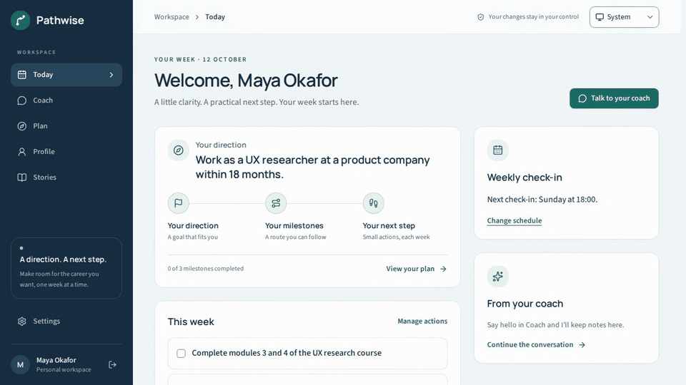

# Pathwise
Your AI-assisted career coach

<!--  — recorded per CONTRIBUTING.md -->

- One coach that remembers your background, values, constraints, and goals.
- Career paths grounded in occupational data, with skill gaps and practical routes.
- A north star, milestones, and small weekly actions you can edit yourself.
- Check-ins, achievement stories, and proposed changes that wait for your approval.
- Self-hosting, your own AI provider, data export, and account deletion.

## Quick start

1. Run `docker compose up` from this checkout.
2. Open http://localhost:3000 and register. That account becomes admin.

## Try the demo persona

Run `SEED_DEMO=true docker compose up` to load a disposable career changer with a profile, stories, conversation, and plan. Get a sign-in password with `docker compose exec worker pathwise admin reset-password demo@pathwise.local`. The demo user does not take the first real registrant's admin role. See [self-hosting](docs/self-hosting.md) for the CLI alternative.

## Architecture

```
┌───────────────────────── docker compose ──────────────────────────┐
│  ┌─ init (one-shot) ─┐                                            │
│  │ secrets · migrate │──── must exit 0 before web/worker start    │
│  │ taxonomy import   │                                            │
│  └───────────────────┘                                            │
│  ┌──────────── web (Next.js 16) ─────────────┐   ┌── worker ──┐   │
│  │ App Router UI · Route handlers (chat SSE) │   │ pg-boss    │   │
│  │ Server Actions · Better Auth   :3000      │   │ consumers  │   │
│  └───────────────┬───────────────────────────┘   └─────┬──────┘   │
│                  ▼  all three run the same image       ▼          │
│        ┌─────────────────── packages/core ───────────────────┐    │
│        │ agent runtime · skills · workflows · memory curator │    │
│        │ domain services · db (Drizzle) · llm · mail · crypto│    │
│        └───────────────────────┬─────────────────────────────┘    │
│        ┌─ postgres (pgvector) ─┐  ┌─ volumes ───────────────────┐ │
│        │ app data · job queue  │  │ pathwise-db · pathwise-files│ │
│        │ taxonomy · embeddings │  │ pathwise-secrets            │ │
│        └───────────────────────┘  └─────────────────────────────┘ │
└───────────────────────────────────────────────────────────────────┘
        outbound only: LLM providers / custom endpoints, SMTP
```

Domain and agent logic live in `packages/core`; web and worker are thin adapters. Read the [architecture guide](docs/architecture.md).

## Docs

- [Architecture](docs/architecture.md)
- [Adding a skill](docs/adding-a-skill.md)
- [Adding a provider](docs/adding-a-provider.md)
- [Memory model](docs/memory-model.md)
- [Self-hosting](docs/self-hosting.md)

## Development

```bash
pnpm install
pnpm dev            # dev database + init + web + worker
pnpm lint
pnpm typecheck
pnpm test           # unit tests
pnpm test:int       # integration tests (needs Docker)
pnpm e2e            # Playwright against a fresh compose stack
```

See [CONTRIBUTING.md](CONTRIBUTING.md) for test layers, manual smoke/evals, and recording the demo.

## License

[AGPL-3.0](LICENSE); see [NOTICE](NOTICE) for O*NET and ESCO attribution.
