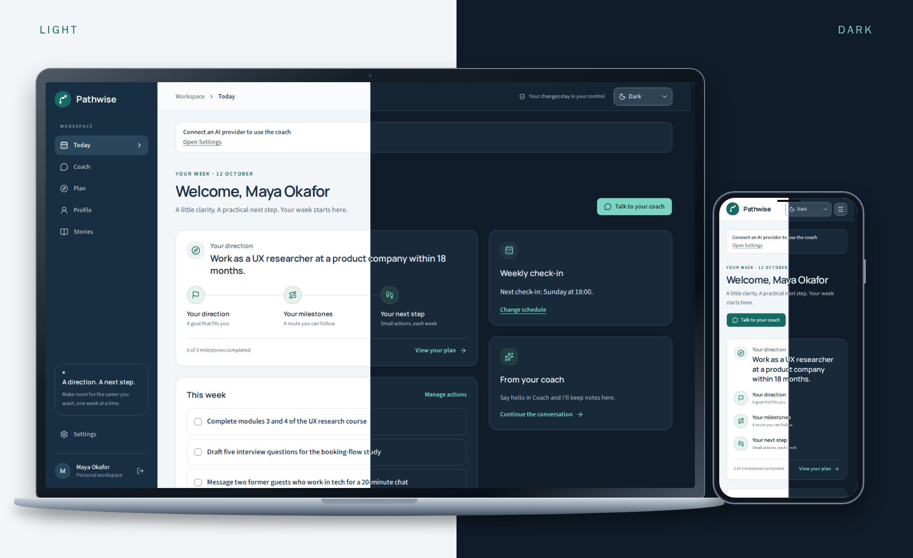
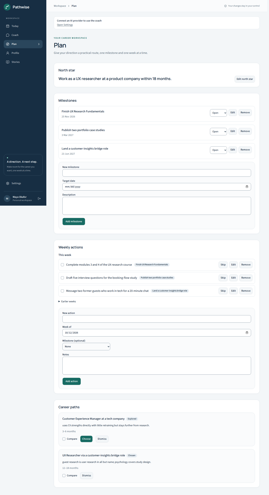
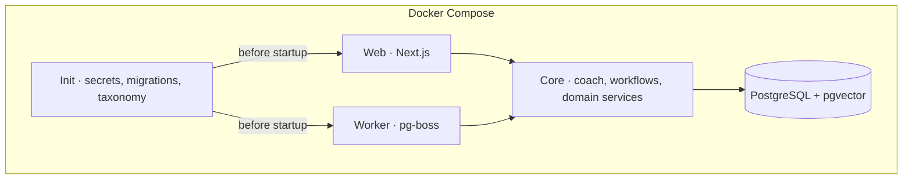

<p align="center">
  
</p>

<h1 align="center">Turn career uncertainty into a plan you can act on.</h1>

<p align="center">
  A self-hosted AI career coach that remembers your context, explores career paths,<br>
  and helps you take the next step. Your provider. Your pace. Your decisions.
</p>

<p align="center">
  <a href="#quick-start">Quick start</a> ·
  <a href="docs/self-hosting.md">Self-hosting</a> ·
  <a href="#documentation">Documentation</a> ·
  <a href="CONTRIBUTING.md">Contributing</a>
</p>



*At your desk or on the go, in light or dark mode. Real demo-persona screenshots in programmatically rendered device frames.*

## From a direction to your next step

### 1. Build your context

Bring your experience, values, interests, and practical constraints into one place. Start with your CV or a conversation, then review what the coach learns. Your profile and achievement stories give future conversations somewhere to begin.

### 2. Explore your options

Compare career paths grounded in occupational data. Identify transferable skills, understand the gaps, and explore practical routes that fit your circumstances. The bundled taxonomy includes O*NET; see the [architecture guide](docs/architecture.md#mock-mode-and-taxonomy) for source details.

### 3. Make steady progress

Choose a north star, break it into milestones, and give this week a few manageable actions. Weekly check-ins help you reflect and adjust. The coach proposes changes to your plan and stories for you to approve, edit, or reject.

<details>
<summary><strong>See the career plan</strong></summary>



</details>

<details>
<summary><strong>Watch the demo</strong></summary>


</details>

## Quick start

You need **Git and Docker with Compose v2**. Clone the repository and start the stack:

```bash
git clone https://github.com/git-akihakune/Pathwise.git
cd Pathwise
docker compose up
```

Once the stack is ready:

1. Open [localhost:3000](http://localhost:3000) and register. The first real account becomes admin.
2. Configure your own AI provider in **Settings**, or an instance provider in **Admin**.
3. Start a conversation with the coach, or build your profile and plan manually.

No `.env` file or manual database setup is needed. Initialization creates secrets, applies migrations, and imports the bundled occupational data. No fallback AI key is supplied; manual editing works without a provider.

For local models, deployment settings, email, backups, and upgrades, read the [self-hosting guide](docs/self-hosting.md).

### Try a populated workspace

From the checkout, start with the disposable demo persona:

```bash
SEED_DEMO=true docker compose up
```

In another terminal, generate a sign-in password:

```bash
docker compose exec worker pathwise admin reset-password demo@pathwise.local
```

Sign in as `demo@pathwise.local` to explore a profile, achievement stories, conversation, and career plan. The demo account leaves the admin role available for the first real registrant. To add the demo to an existing instance, see [demo seeding](docs/self-hosting.md#demo-persona).

## Your data and decisions stay in your control

- **Host it yourself.** Run the web app, worker, and database together with Docker Compose. No managed-service dependency is required.
- **Choose your AI provider.** Use your own provider or a compatible local model. Provider keys are encrypted at rest and stay server-side. Your chosen provider receives the context needed for coaching requests.
- **Review proposed changes.** Coach tools create proposals for changes to your profile, paths, plan, and stories. You decide what gets applied; you can also edit directly.
- **Inspect what the coach remembers.** Review and manage memories. Sensitive or lower-confidence memories wait for review; high-confidence, non-sensitive memories can be saved automatically.
- **Take your data with you.** Export your account data and original uploads, or delete your account from Settings. Operator backups and copies held by external providers are outside account deletion.

Read the [memory and data rights guide](docs/memory-model.md) for the full behavior.

## Documentation

| Guide | What you'll find |
| --- | --- |
| [Self-hosting](docs/self-hosting.md) | Deployment, local models, configuration, backups, and the admin CLI |
| [Memory and data rights](docs/memory-model.md) | What the coach remembers, review rules, export, and deletion |
| [Architecture](docs/architecture.md) | Runtime boundaries, chat flow, approvals, workflows, and background jobs |
| [Adding a skill](docs/adding-a-skill.md) | Extend the coach's capabilities through the skill registry |
| [Adding a provider](docs/adding-a-provider.md) | Provider integration and capability fallbacks |
| [Contributing](CONTRIBUTING.md) | Development setup, test layers, and contribution conventions |

## Architecture at a glance



`packages/core` owns domain, agent, and database logic; `apps/web` and `apps/worker` are thin adapters. One coach uses registry skills, persisted onboarding and check-in workflows, and a background memory curator. The three application entrypoints share one Docker image.

See the [architecture guide](docs/architecture.md) for implementation details.

## Contributing

Bug reports, documentation improvements, and focused contributions are welcome. Use the devcontainer for Node 24, pnpm, and Docker, then start development with:

```bash
pnpm install
pnpm dev
```

Read [CONTRIBUTING.md](CONTRIBUTING.md) for checks, test layers, and the design process. CI runs with mock AI models and requires no LLM API keys.

## License and attribution

Pathwise is open source under [AGPL-3.0](LICENSE). See [NOTICE](NOTICE) for occupational-data attribution, including O*NET and ESCO.
